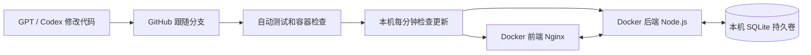

# 智作台 · 本机服务器版

中文 AI 工作台，提供前端界面、数据后端、SQLite 数据库及 Linux Docker Desktop 部署。在 GPT / Codex 中开发代码，通过 GitHub 保存版本，由本机后台服务自动部署通过检查的新提交。

**工作空间数据后端已实现；模型回复仍为明确标注的演示，尚未调用模型 API。** 开发、保存和部署流程无需 OpenAI API 密钥。

## 第一次安装

Linux 本机需要 Git、Python 3 和已启动的 Docker Desktop。以日常使用 Docker Desktop 的用户运行：

```bash
git clone --branch codex/gpt-docker-github https://github.com/wen3343055414-sys/AI---WQS.git
cd AI---WQS
bash scripts/install-local-server.sh --branch codex/gpt-docker-github
```

打开 **http://127.0.0.1:3000**，首次访问在网页设置密码。Docker Desktop → Containers 中会出现 `ai-wqs-server`，包含 `frontend` 和 `backend`。

上面跟随当前开发分支，适合在 GPT 中继续迭代。功能合并到主分支后，可重新运行安装脚本并指定 `--branch main`。端口被占用时加 `--port 3001`；局域网访问加 `--bind 0.0.0.0`。

## 自动同步



- **代码版本**：本机跟随选定分支，只部署同一提交通过验收后的版本。GitHub 分支与 PR 继续作为开发和审阅入口。
- **业务数据**：会话、提示词、资料、任务和设置由后端统一保存。前端自动保存，其他已登录页面约每 8 秒同步；并发冲突保留本页内容并提示处理。
- **升级与备份**：升级前及运行期间每天备份数据库，保留最近 30 份。容器重建保留数据，新版启动失败时恢复上一代码版本。
- **浏览器版本**：无未完成输入时自动刷新到新版本；正在编辑时保留输入并提示刷新。

GitHub 保存代码与公开开发摘要，业务数据保存在本机数据库。自动更新需要电脑开机、Docker 引擎运行并能连接 GitHub。Docker Desktop 使用用户登录会话；本配置不保证退出登录或休眠期间持续提供服务。

## 已有功能

首页、AI 演示对话、提示词管理与收藏、知识资料与正文搜索、任务记录、全局搜索、深色主题、JSON 备份恢复，以及本机登录、数据库保存、同步状态和运行版本。

首次登录空数据库时，会迁入同一站点原有的有效浏览器数据。支持 UTF-8 文本资料；容量边界见 [服务器使用指南](docs/local-server.md)。

## 日常使用

在 GPT / Codex 中选择这个仓库和本机跟随的分支修改代码。提交推送后，本机等待 CI 成功，再自动更新前后端。其他分支的修改需要先合入跟随分支。

```bash
# 本机版本和自动更新日志
python3 ~/.local/share/ai-wqs-server/deployer.py status
journalctl --user -u ai-wqs-update.service -n 60
systemctl --user status ai-wqs-update.timer

# 立即更新、备份或回退
python3 ~/.local/share/ai-wqs-server/deployer.py update
python3 ~/.local/share/ai-wqs-server/deployer.py backup
python3 ~/.local/share/ai-wqs-server/deployer.py rollback
```

自定义 XDG_DATA_HOME 时使用对应数据目录。完整说明见 [服务器使用指南](docs/local-server.md)。

## 开发与验证

Node.js 24.10.0+，零第三方运行依赖：

```bash
npm start             # http://127.0.0.1:3000，数据库在 ./data
npm test
python3 -m unittest discover -s tests -p 'test_*.py'
npm run build
docker compose config --quiet
```

手动启动 Docker 使用 `bash scripts/start-linux.sh`。直接修改前端可使用开发挂载：

```bash
docker --context desktop-linux compose -f compose.yaml -f compose.dev.yaml up --build --detach --wait
```

CI 验证应用、更新器规则和实际前后端容器。`GET /api/health` 表示服务可用，`GET /api/status` 提供版本与登录状态，工作空间接口需要登录。

## 静态部署与保存规则

`npm run build` 仍生成可托管的 dist/，原有 GitHub Pages 工作流继续保留。静态版本使用浏览器保存，与本机数据库独立；数据库和自动部署通过本机 Docker 服务使用。

遵循 [AGENTS.md](AGENTS.md)：验证后更新公开日志、提交推送任务分支，通过 PR 交付，不自动合并主分支。真实凭据、数据库、业务数据和聊天全文不进入公开代码仓库。
