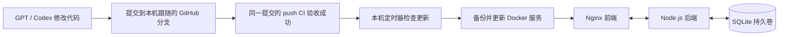

# 智作台 · 中文 AI 工作台

把会话、提示词、知识资料和任务放在同一个工作空间。智作台提供中文界面、账号登录、SQLite 数据保存，以及从 GitHub 到本机 Docker 的自动更新流程。

> 工作台包含账号注册、账号／邮箱密码登录和独立工作空间。Windows 管理端可配置多服务商真实模型；未配置模型时明确显示未就绪，历史演示记录保留标记。Linux Docker 数据服务与 Windows 管理服务的安装方式分别见下文。

## 功能概览

| 功能 | 功能说明 |
| --- | --- |
| 会话与任务 | 配置 Windows 模型桥接后支持真实对话、模型选择、重试与重新生成、历史会话、复制与导出；任务显示真实执行状态 |
| 提示词 | 模板浏览、编辑、分类与收藏，常用提示词显示在首页 |
| 知识资料 | 添加资料、阅读 UTF-8 文本、搜索正文、将资料带入对话输入框 |
| 全局搜索 | 搜索提示词、会话、资料与任务，支持 `Ctrl / ⌘ + K` |
| 账号与工作空间 | 注册、账号或邮箱密码登录，每个账号使用独立工作空间，兼容旧版密码用户 |
| 数据与同步 | SQLite 持久保存、自动保存、同账号跨页面同步、冲突处理和 JSON 导入导出 |
| 界面与运维 | 深色主题、手机布局、同步状态、运行版本、数据库备份与代码回退 |
| Windows 管理端 | 服务启停、多服务商模型、Token 用量与月限额、工作台域名和局域网入口管理 |
| 网站编辑与发布 | 多文件静态网站、修订与草稿预览、发布快照、独立访客端口和可启停的公网通道 |

## 快速开始（Linux）

### 1. 准备环境

安装 Git、Python 3 和 Docker Desktop for Linux，打开 Docker Desktop 并等待引擎就绪。自动更新还需要可用的 `systemd` 用户服务。以日常使用 Docker Desktop 的用户运行安装命令；Node.js 由容器提供，无需在本机单独安装。

### 2. 安装主分支

```bash
git clone --branch main https://github.com/wen3343055414-sys/AI---WQS.git
cd AI---WQS
bash scripts/install-local-server.sh --branch main
```

安装程序配置 `ai-wqs-server` 项目、`frontend`／`backend` 容器及后台更新定时器。首次部署需要等待当前提交的 GitHub 验收通过；尚未通过时，定时器会继续检查。

### 3. 打开工作台

访问 [http://127.0.0.1:3000](http://127.0.0.1:3000)。首次访问注册账号与邮箱，设置 **10–128 个字符**的密码；之后可用账号密码或邮箱密码登录。旧版密码用户使用账号 `admin` 和原密码，原有数据保留。

安装命令可追加以下参数：

| 参数 | 用途 |
| --- | --- |
| `--port 3001` | 改用端口 3001，访问地址相应调整 |
| `--bind 0.0.0.0` | 允许局域网连接，其他设备使用本机局域网 IP 和端口登录 |
| `--no-systemd` | 手动运行，不安装后台更新定时器 |

默认仅监听本机。局域网连接还取决于防火墙和网络设置。已有安装的分支、数据目录与维护方式见 [服务器使用指南](docs/local-server.md)。

正在部署 PR #5 整合版本时，clone 与安装命令均指定 `--branch codex/gpt-docker-github`，以匹配仓库的本机跟随分支。已有安装先检查更新器的仓库、分支、端口与 Docker 项目配置；更换分支仍需满足快进更新规则，不要创建新的数据卷来代替升级。主分支只会在 PR 合入后包含相应源码。

## 账号与数据保存

- **账号隔离**：同一账号在不同设备登录后读取相同工作空间，新账号的数据彼此独立。旧版兼容账号首次登录空工作空间时，可迁入同一站点的有效旧浏览器数据。
- **登录方式**：账号与邮箱密码登录可用。手机验证码入口已提供，短信服务尚未接入；邮箱目前用于登录标识，邮箱验证与邮件找回密码尚未接入。详见 [账户登录与注册](docs/authentication.md)。
- **保存位置**：本机服务器模式将业务数据保存在 Docker 持久卷中，容器重建后继续保留；静态部署使用当前浏览器存储。
- **资料范围**：TXT、Markdown、CSV、JSON 支持 UTF-8 正文读取，每个文件不超过 1 MB，正文合计不超过 150 万字符；其他格式仅保存文件信息。完整容量限制见 [服务器使用指南](docs/local-server.md)。

GitHub 保存应用代码和公开开发摘要。密码、数据库、业务内容、API 密钥与聊天全文不进入公开仓库。

## 自动更新与数据同步



- **代码更新**：本机只跟随安装时指定的分支，定时器每次任务结束约一分钟后再次检查。任务分支的修改需经审阅合入跟随分支，才会进入该安装的更新流程。
- **数据同步**：页面自动保存修改，其他已登录页面约每 8 秒检查更新。离线修改保留待发送缓存，恢复连接后重试；发生并发冲突时保留本页内容并提示选择。
- **版本切换**：没有未完成输入时，浏览器自动刷新到新版本；正在编辑时保留输入并提示刷新。
- **备份与回退**：升级前及运行期间每天备份数据库，保留最近 30 份。新版启动失败时恢复上一代码版本；代码回退保留当前业务数据，不恢复过去的业务内容。

自动更新需要本机已完成安装、电脑开机、Docker 引擎运行且能够访问 GitHub。Docker Desktop 依赖用户登录会话；休眠、断电或退出登录期间不保证持续服务。云端提交代码后，由本机定时器执行部署。

## 日常维护

以下命令用于默认 Linux 安装：

```bash
# 查看当前版本与更新日志
python3 ~/.local/share/ai-wqs-server/deployer.py status
systemctl --user status ai-wqs-update.timer
journalctl --user -u ai-wqs-update.service -n 60

# 立即检查更新、备份数据库、回退上一代码版本
python3 ~/.local/share/ai-wqs-server/deployer.py update
python3 ~/.local/share/ai-wqs-server/deployer.py backup
python3 ~/.local/share/ai-wqs-server/deployer.py rollback

# 暂停或恢复自动更新
systemctl --user stop ai-wqs-update.timer
systemctl --user start ai-wqs-update.timer
```

自定义 `XDG_DATA_HOME` 时，使用对应的数据目录。数据库快照默认仍在同一电脑，可在设置中导出 JSON 并另存备份。需要长期停止服务时，先暂停定时器，再在 Docker Desktop 中停止 `ai-wqs-server`；保留持久卷即可保留数据库。

## 本地开发与验证

直接运行源码需要 **Node.js 24.10.0 及以上的 24.x 版本**，运行时无第三方依赖：

```bash
npm ci
npm start             # http://127.0.0.1:3000，数据库默认在 ./data
```

开发时可用 `npm run dev` 监听源码变化。提交前运行：

```bash
npm test
node scripts/check-source.mjs
python3 -m unittest discover -s tests -p 'test_*.py'
python3 -m unittest discover -s admin/tests -p 'test_*.py'
npm run build
docker compose config --quiet
```

手动启动 Docker 可运行 `bash scripts/start-linux.sh`；该方式不安装后台更新定时器。前端挂载开发模式可运行：

```bash
docker --context desktop-linux compose -f compose.yaml -f compose.dev.yaml up --build --detach --wait
```

Windows 将工作台 Python 测试命令改为 `python -m unittest discover -s tests -p 'test_windows_*.py'`，另运行管理端 Python 测试，避免加载仅 Linux 支持的 `fcntl` 更新器。`npm test` 同时验证工作台与管理端，并在 Windows 验证 DPAPI。

GitHub CI 验证 Linux 和 Windows 应用、Python 更新器规则、源码边界、前后端容器 HTTP 行为及登录界面。`GET /api/health` 用于健康检查，`GET /api/status` 提供版本与登录状态，工作空间接口需要登录。

## 静态部署

`npm run build` 生成 `dist/`，可用于静态托管。GitHub Pages 需先在仓库 **Settings → Pages → Source** 选择 **GitHub Actions**，再使用“部署 GitHub Pages”工作流发布构建产物。

静态版本使用浏览器存储，不包含账号登录、服务器数据库或本机模型桥接。历史演示记录保留标记。静态托管不会启动 Node.js、SQLite、Docker 或 Windows 管理服务。

## Windows 管理端与真实模型接入

完整功能在 [`codex/gpt-docker-github` 跟随分支](https://github.com/wen3343055414-sys/AI---WQS/tree/codex/gpt-docker-github) 集中开发，通过 [PR #5](https://github.com/wen3343055414-sys/AI---WQS/pull/5) 审阅。工作台默认入口为 **http://127.0.0.1:3000**，Windows 管理端为 **http://127.0.0.1:3100**，网站访客入口默认使用独立端口 **3200**：

- 独立 Windows 管理服务，提供服务启停、日志、备份、版本更新和局域网入口管理。
- 多服务商与多模型设置，支持 OpenAI 兼容、Anthropic Messages 和 Gemini 原生文本协议；配置可用模型后，工作台使用真实模型对话。
- Windows DPAPI 本机密钥保管、实际 Token 用量统计与月限额。
- 静态网站模板、多文件与文字编辑、图片导入、项目导入导出、草稿预览和独立发布快照。
- 实际 Cloudflare Quick Tunnel 公网转发、工作台域名与局域网管理。临时通道地址可能随重建变化，电脑与网络需要持续运行。

在管理端保存服务商连接、启用模型并设置默认模型后，前端自动获取已启用模型；对话框也可选择其他模型。没有可用模型时禁用发送，不提供模拟回复。密钥、管理数据库和网站内容保存在本机运行目录。

安装、发布与自更新步骤见 [服务端说明](admin/README.md)、[代码同步说明](docs/source-sync.md) 和 [网站发布与公网通道](admin/docs/website-tunnel.md)。Linux 原有 systemd 安装入口继续保留，不包含 Windows DPAPI 管理服务；运行目录、未提交聊天片段和 GitHub Pages 不作为本机发布源码。

## 项目文档

- [服务器使用指南](docs/local-server.md)：安装配置、数据边界、接口、备份与回退。
- [账户登录与注册](docs/authentication.md)：账号规则、旧用户迁移与短信状态。
- [开发与本机服务协作](docs/development-workflow.md)：提交、GitHub 验收与本机部署流程。
- [项目工作与保存规则](AGENTS.md)：验证、公开工作日志、任务分支和 PR 交付约定。

- [多模型管理说明](docs/multi-model-settings.md)：连接、模型目录、协议和用量边界。
- [网站发布与公网通道](admin/docs/website-tunnel.md)：草稿、发布快照与公网入口限制。
