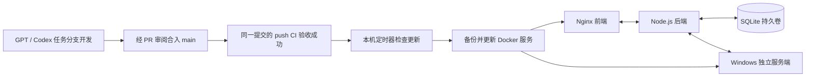

# 智作台 · 中文 AI 工作台

把会话、提示词、知识资料和任务放在同一个工作空间。智作台提供中文界面、账号登录、SQLite 数据保存，以及从 GitHub 到本机 Docker 的自动更新流程。

> 本页对应完整发布分支 **`main`**：账号注册、账号／邮箱密码登录、数据后端和独立 Windows 服务端统一维护。配置可用模型接口后，工作台发送真实文本对话并统计 Token；已有演示历史保留标记。仅安装和浏览工作台不需要 API 密钥。

## 功能概览

| 功能 | 当前主分支支持 |
| --- | --- |
| 对话与历史 | 真实模型文本对话（需配置独立服务端）、按会话查看历史、正文搜索、继续对话、复制导出与请求重试 |
| 信息收集与分析 | 聚合公开信源、订阅关键词提醒、收藏信息，生成带来源的简报 |
| 提示词 | 模板浏览、编辑、分类与收藏 |
| 知识资料 | 添加资料、阅读 UTF-8 文本、搜索正文、将资料带入对话输入框 |
| 全局搜索 | 用 `Ctrl / ⌘ + K` 按类型查找任务、对话、资料与提示词，或进入页面、创建记录和搜索信息流 |
| 账号与工作空间 | 注册、账号或邮箱密码登录，每个账号使用独立工作空间，兼容旧版密码用户 |
| 数据与同步 | SQLite 持久保存、自动保存、同账号跨页面同步、冲突处理和 JSON 导入导出 |
| 界面与运维 | 深色主题、手机布局、同步状态、运行版本、数据库备份与代码回退 |
| 插件协作 | GitHub 官方 MCP、自定义远程 MCP、真实工具发现和调用、执行前确认、调用状态记录 |
| 模型与服务端 | 多服务商、多模型选择、独立加密密钥、实际 Token 用量、月限额、服务启停、日志及局域网入口 |

## 快速开始（Linux）

### 1. 准备环境

安装 Git、Python 3 和 Docker Desktop for Linux（Compose 2.33.1+），打开 Docker Desktop 并等待引擎就绪。自动更新还需要可用的 `systemd` 用户服务。以日常使用 Docker Desktop 的用户运行安装命令；Node.js 由容器提供，无需在本机单独安装。项目显式使用 IPv4 容器网络，匹配后端和 Windows 模型桥接；不修改 Docker Desktop 全局网络设置。

### 2. 安装主分支

```bash
git clone --branch main https://github.com/wen3343055414-sys/AI---WQS.git
cd AI---WQS
bash scripts/install-local-server.sh --branch main
```

安装程序配置 `ai-wqs-server` 项目、`frontend`／`backend` 容器及后台更新定时器。首次部署需要等待当前提交的 GitHub 验收通过；尚未通过时，定时器会继续检查。

### 3. 打开工作台

访问 [http://127.0.0.1:3000](http://127.0.0.1:3000)。首次访问注册账号与邮箱，设置 **10–128 个字符**的密码；之后可用账号密码或邮箱密码登录。旧版密码用户使用账号 `admin` 和原密码，原有数据保留。

安装命令可追加以下参数：

| 参数 | 用途 |
| --- | --- |
| `--port 3001` | 改用端口 3001，访问地址相应调整 |
| `--bind 0.0.0.0` | 允许局域网连接，其他设备使用本机局域网 IP 和端口登录 |
| `--no-systemd` | 手动运行，不安装后台更新定时器 |

默认仅监听本机。局域网连接还取决于防火墙和网络设置。已有安装的分支、数据目录与维护方式见 [服务器使用指南](docs/local-server.md)。

## 信息收集与分析

打开工作台默认进入「信息收集与分析」。服务端每 5 分钟检查启用的信源，支持立即更新与添加公开 HTTPS RSS 或 Atom。页面显示各信源的更新时间和连接状态，信息按主题整理，并保留原文链接。

关键词订阅会将新匹配的信息写入站内提醒。工作台在线时显示新提醒，也可以在支持通知的浏览器上开启桌面通知。选择信息后可以按主题整理，或调用工作台已配置的模型生成中文分析简报。简报包含引用来源，可复制或导出 Markdown。采集记录、订阅、收藏和简报随工作台 SQLite 备份保留。

## 新对话与历史对话

侧栏顶部的 **新对话** 打开空白会话。在 AI 对话页可搜索会话标题和消息正文。会话菜单可重命名、置顶或导出，历史对话页也可只看置顶。会话标题和置顶随账号同步。

原 `#tasks` 链接继续打开历史对话。此调整不删除已有会话、消息或底层请求记录，完整工作空间备份仍包含原数据。

## 任务、插件与使用帮助

侧栏的 **任务** 可以按状态、截止日期和关键词筛选。设有截止日期的待办按日期先后排列，界面会标出已逾期和今天到期的任务。在对话消息旁点击 **添加到任务** 可填好任务名称和备注，再编辑保存。任务列表的 **原对话** 可以打开对应会话。

**插件** 位于历史对话上方，可连接 GitHub 官方 MCP 或其他远程 MCP 服务，真实发现并执行工具。可搜索已发现的工具、启停和断开连接，并在对话中确认操作后将实际结果交给模型继续工作。GitHub 需在本应用内单独填写个人访问令牌；凭据加密保存在后端，按账号隔离，不包含在 JSON 备份中。详见 [插件连接与授权](docs/plugins.md)。

在提示词编辑页可复制当前内容为新提示词。知识库支持修改资料名称和分类，在预览中下载已保存的纯文本。把资料或提示词带入新对话时，会追加到已有草稿。

在 **设置 → 我的工作空间** 可查看最近同步时间，恢复备份前可先导出当前副本。使用说明从 **设置 → 使用帮助** 打开。

点击「工作空间」左侧的按钮可收起或展开单列导航。桌面收起后内容区延伸到左侧，浏览器会记住显示状态。也可以按 **Ctrl + Shift + S** 或 **⌘ + Shift + S** 切换。手机可点击遮罩或按 Esc 关闭抽屉。

## 账号与数据保存

- **账号隔离**：同一账号在不同设备登录后读取相同工作空间，新账号的数据彼此独立。旧版兼容账号首次登录空工作空间时，可迁入同一站点的有效旧浏览器数据。
- **登录方式**：账号与邮箱密码登录可用。手机验证码入口已提供，短信服务尚未接入；邮箱目前用于登录标识，邮箱验证与邮件找回密码尚未接入。详见 [账户登录与注册](docs/authentication.md)。
- **保存位置**：本机服务器模式将业务数据保存在 Docker 持久卷中，容器重建后继续保留；静态部署使用当前浏览器存储。
- **资料范围**：TXT、Markdown、CSV、JSON 支持 UTF-8 正文读取，每个文件不超过 1 MB，正文合计不超过 150 万字符；其他格式仅保存文件信息。完整容量限制见 [服务器使用指南](docs/local-server.md)。

GitHub 保存应用代码和公开开发摘要。密码、数据库、业务内容、API 密钥与聊天全文不进入公开仓库。

## 自动更新与数据同步



- **代码更新**：本机发布跟随 `main`，约每分钟检查。任务分支的修改需经 PR 合入 `main`，并通过该 SHA 的 push CI，才会进入更新流程；还需构建和健康检查时间，不保证提交后立即上线。
- **数据同步**：页面自动保存修改，其他已登录页面约每 8 秒检查更新。离线修改保留待发送缓存，恢复连接后重试；发生并发冲突时保留本页内容并提示选择。
- **版本切换**：没有未完成输入时，浏览器自动刷新到新版本；正在编辑时保留输入并提示刷新。
- **备份与回退**：工作空间数据库升级前及每天备份，保留最近 30 份；Windows 管理数据库在升级前另建快照。新版启动失败时恢复上一代码版本，保留当前业务数据。

自动更新需要本机已完成安装、电脑开机、Docker 引擎运行且能够访问 GitHub。Docker Desktop 依赖用户登录会话；休眠、断电或退出登录期间不保证持续服务。云端提交代码后，由本机定时器执行部署。

## 日常维护

以下命令用于默认 Linux 安装：

```bash
# 查看当前版本与更新日志
python3 ~/.local/share/ai-wqs-server/deployer.py status
systemctl --user status ai-wqs-update.timer
journalctl --user -u ai-wqs-update.service -n 60

# 立即检查更新、备份数据库、回退上一代码版本
python3 ~/.local/share/ai-wqs-server/deployer.py update
python3 ~/.local/share/ai-wqs-server/deployer.py backup
python3 ~/.local/share/ai-wqs-server/deployer.py rollback

# 暂停或恢复自动更新
systemctl --user stop ai-wqs-update.timer
systemctl --user start ai-wqs-update.timer
```

自定义 `XDG_DATA_HOME` 时，使用对应的数据目录。数据库快照默认仍在同一电脑，可在设置中导出 JSON 并另存备份。需要长期停止服务时，先暂停定时器，再在 Docker Desktop 中停止 `ai-wqs-server`；保留持久卷即可保留数据库。

## 本地开发与验证

直接运行源码需要 **Node.js 24.10.0 及以上的 24.x 版本**，运行时无第三方依赖：

```bash
npm ci
npm start             # http://127.0.0.1:3000，数据库默认在 ./data
```

开发时可用 `npm run dev` 监听源码变化。提交前运行：

```bash
npm test
python3 -m unittest discover -s tests -p 'test_*.py'
node scripts/check-source.mjs
npm run build
docker compose config --quiet
```

手动启动 Docker 可运行 `bash scripts/start-linux.sh`；该方式不安装后台更新定时器。前端挂载开发模式可运行：

```bash
docker --context desktop-linux compose -f compose.yaml -f compose.dev.yaml up --build --detach --wait
```

GitHub CI 验证应用、Python 更新器规则、前后端容器 HTTP 行为及登录界面。`GET /api/health` 用于健康检查，`GET /api/status` 提供版本与登录状态，工作空间接口需要登录。

Windows 运行 `python -m unittest discover -s tests -p 'test_windows_*.py'`，另运行 `python -m unittest discover -s admin/tests -p 'test_*.py'`；Windows 密钥测试可通过 `AI_WQS_TEST_PYTHON` 指定实际 Python 路径。

## 静态部署

`npm run build` 生成 `dist/`，可用于静态托管。GitHub Pages 需先在仓库 **Settings → Pages → Source** 选择 **GitHub Actions**，再使用“部署 GitHub Pages”工作流发布构建产物。

静态版本使用浏览器存储，可展示界面和保存浏览器数据。账号登录、数据库、真实模型对话和自动更新依赖后端与对应服务端；静态托管不会启动 Node.js、SQLite、Docker 或保管模型密钥。

## Windows 管理端与真实模型接入

完整发布源码包含独立 Windows 管理服务，入口为 [http://127.0.0.1:3100](http://127.0.0.1:3100)，工作台入口为 [http://127.0.0.1:3000](http://127.0.0.1:3000)：

- 独立 Windows 管理服务提供服务启停、日志、备份、版本更新和局域网入口管理。可从服务列表打开对应日志，按关键词筛选日志、备份和操作记录，并查看前端、后端和管理服务实际运行的版本是否一致。
- 多服务商与多模型设置，支持 OpenAI 兼容、Anthropic Messages 和 Gemini 原生文本协议；配置可用模型后，工作台使用真实模型对话。
- Windows DPAPI 本机密钥保管、实际 Token 用量统计与月限额。

安装与运行要求见 [服务端说明](admin/README.md) 和 [代码同步说明](docs/source-sync.md)。Linux 安装入口部署工作台前后端，Windows 管理服务依赖 DPAPI 与任务计划。原安装从 `codex/gpt-docker-github` 切换到 `main` 前，目标必须包含当前发布历史及完整服务源码；不能跳过分叉检查。

## 项目文档

- [服务器使用指南](docs/local-server.md)：安装配置、数据边界、接口、备份与回退。
- [插件连接与授权](docs/plugins.md)：GitHub 权限、远程 MCP、对话操作确认与凭据备份。
- [账户登录与注册](docs/authentication.md)：账号规则、旧用户迁移与短信状态。
- [开发与本机服务协作](docs/development-workflow.md)：提交、GitHub 验收与本机部署流程。
- [项目工作与保存规则](AGENTS.md)：验证、公开工作日志、任务分支和 PR 交付约定。
