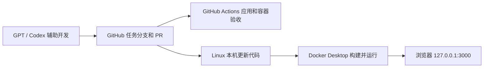

# GPT / Codex、GitHub 与 Linux Docker Desktop

## 三者的分工



GPT / Codex 使用已连接的 GitHub 仓库理解和修改代码。仓库中的 `AGENTS.md` 规定验证、公开摘要、推送与 PR 交付方式。GitHub 保存代码和审阅记录，Docker Desktop 在本机运行相同版本。

云端开发环境与本机 Docker Desktop 是不同环境。这套流程通过 GitHub 同步代码；运行中的任务可以执行开发和提交操作，任务结束后不会自动监控或同步本机。

## 第一次启动

1. Linux 本机安装 Git 和 Docker Desktop for Linux。
2. 打开 Docker Desktop，等待引擎启动。已安装时也可运行 `systemctl --user start docker-desktop`。
3. 从 GitHub 获取仓库。若正在验收未合并的 PR，应切换到该 PR 的开发分支。
4. 在仓库目录运行：

```bash
bash scripts/start-linux.sh
```

脚本会选择 Docker Desktop 的 `desktop-linux` context，在没有该 context 时使用当前 context，然后构建、启动并等待容器健康。它不会修改全局 context，也不会启动或重启 Docker 守护进程。

打开 <http://127.0.0.1:3000>。在 Docker Desktop → Containers → `ai-wqs` 中可查看状态、日志和端口。

## 日常更新

让 GPT / Codex 在任务分支上实现功能、执行检查并创建 PR。审阅合并后，在本机项目目录运行：

```bash
git switch main
git pull --ff-only
bash scripts/start-linux.sh
```

验收未合并 PR 时，切换到 PR 指定的分支并更新该分支。Docker 构建使用本机当前目录的代码，GitHub 的改动需要先同步到本机。

## 本机修改前端

```bash
docker --context desktop-linux compose -f compose.yaml -f compose.dev.yaml up --build --detach --wait
```

这个开发配置把 `public/` 以只读方式挂载到容器。修改 HTML、CSS 或前端 JavaScript 后，刷新浏览器即可看到变化。修改服务端、Dockerfile 或依赖配置后重新构建。

## 常用操作

```bash
# 查看容器
docker --context desktop-linux compose ps

# 查看日志，Ctrl+C 退出日志跟踪
docker --context desktop-linux compose logs --follow

# 验证运行中的服务
node scripts/check-container.mjs

# 停止本项目容器
docker --context desktop-linux compose down
```

如果使用 Docker Engine 而非 Docker Desktop，以上命令省略 `--context desktop-linux`。

本机端口被占用时：

```bash
WORKBENCH_PORT=3001 bash scripts/start-linux.sh
node scripts/check-container.mjs http://127.0.0.1:3001
```

运行容器无需本机安装 Node.js；仅手动运行上述 HTTP 检查脚本时需要本机 Node.js 24。

## GitHub 自动验收

`验收工作台` 工作流支持 PR、`main`、`feat/**`、`codex/**` 和手动触发：

1. 使用 Node.js 24 检查项目锁文件、运行 `npm test` 和 `npm run build`。
2. 构建 Docker 镜像；镜像构建阶段也执行应用测试与静态构建。
3. 启动 Compose 服务并等待 `/api/health` 健康检查。
4. 检查首页、JS/CSS、健康接口、HEAD、405 和敏感路径不可访问。
5. 失败时输出日志，最后清理测试容器。

Docker 运行阶段使用非 root 用户、只读根文件系统和 3000 端口，主机端口仅绑定到 `127.0.0.1`。无需镜像仓库账号，也不自动发布镜像或合并代码。GitHub Pages 的原有静态发布流程独立运行。

## 数据位置

工作台的会话与资料保存在浏览器 localStorage。重建容器不会清理浏览器数据；更换协议、域名、端口、浏览器或设备属于不同存储空间。保持使用同一个地址，清理浏览器前先在设置中导出备份。

工作台仍是前端演示，未调用真实模型。这与 GPT / Codex 辅助开发代码是两个独立功能；后续需要真实 AI 时，单独配置服务端模型调用。
